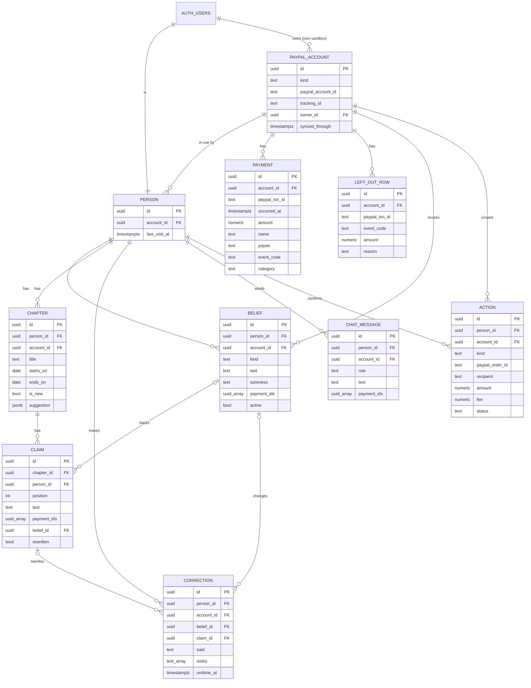

# PLAN

## Words used in this plan
| Word | Plain meaning |
| --- | --- |
| AC (acceptance criterion) | One thing a unit must do before it counts as finished. Written as Given / When / Then: "starting from this situation, when someone does this, this should happen." |
| Anonymous user | A visitor Soul remembers without a sign-up, through their browser. Each one gets a private copy. |
| Anon key | The one Supabase key that's safe to put in the browser. It can only do what the database rules allow. |
| BFF (backend for frontend) | Our own server code. The page talks only to it, and it talks to PayPal, Supabase and the AI, so the keys never reach the browser. |
| Capture | The step after a person approves a payment on PayPal, where Soul tells PayPal to actually move the money. |
| CI (GitHub Actions) | The same automatic checks, run again on GitHub every time code is pushed, as a second check. |
| Consent | The PayPal page where a person allows Soul to read their sandbox payments. |
| Cron / daily job | A task the server runs on its own once a day. |
| Cursor | A bookmark of the newest payment date already read, so Soul only reads what's new. |
| ER diagram | A drawing of the database tables and how they link. |
| Env vars | Settings and keys kept outside the code, in `.env.local` or on Vercel. |
| LCP (largest contentful paint) | The moment the main content first appears on screen. Used to time page speed. |
| LLM | The AI model that writes the story and the chat answers. Here it runs through OpenRouter. |
| Migration | A saved file that changes the database layout, so the same change can be repeated on the live database later. |
| Mock | Made-up data the prototype uses. Each unit replaces it with real data. |
| Order | A PayPal payment request. It waits until the person approves it, then Soul captures it. |
| Prototype | The clickable app approved at G4. It looks finished but runs on mock data. |
| RLS (Row Level Security) | Database rules that stop one person from reading or changing another person's rows. |
| Route | A web address in the app, like `/story`, or a BFF address the page calls, like `/api/story`. |
| Sandbox | PayPal's test system. Accounts and money there are fake. |
| Staging / Prod | Two Supabase projects. Staging is for building and testing. Prod (production) is the live one judges use. |
| T1900, T0300 | PayPal codes for rows that aren't purchases: the starting test balance and the bank top-up behind each payment. Soul leaves them out. |
| gitleaks | A tool that scans code for keys and passwords. It runs before every commit on your computer and again on GitHub, and blocks the commit if it finds one. |
| `npm test` | The one command that runs all the automatic tests. It runs on your computer before every unit report and commit, then again on GitHub. |
| Page states | The versions of a page: normal, loading, empty, error, and stale (old saved data while PayPal can't be reached). |
| Typecheck | An automatic check that the code's pieces fit together. |
| Unit (U0, U1 …) | One complete function, built and tested in one chat. |
| Webhook | A message PayPal sends to Soul on its own when something happens, like a payment completing. |
| Test types | **unit**: checks one small piece of code on its own. **integration**: checks code with the real Staging database. **e2e**: clicks through the real app in the browser. **ci**: the automatic checks on GitHub. **manual**: a person checks by hand. |

## 1. Context & golden path (G1 approved Nov 2, plan G5 approved Nov 3)

**Soul: your money has a story.** PayPal shows a person a list of payments. Soul turns them into a story that remembers, notices things first, and changes its mind when you correct it.

**Problem:** a payment list records what happened, not what it meant. People can't see their habits, the people they support, or what changed, and a chat over payment data answers one question and starts over next time.

**User:** anyone who uses PayPal. Judges can connect their own sandbox account or use our prepared data. The demo video follows the prepared person so the impact case stays concrete.

**Differentiator:** chat over MCP answers and moves on. Soul keeps beliefs about you tied to real payments, speaks up first, and rewrites its story when you correct it.

### Golden path (60–90 seconds)
1. Open Soul and choose: **Try it with our prepared data** (one click) or **Log in with PayPal**, in PayPal's colors and clearly marked sandbox (it opens PayPal's consent page). The note above the second button states the minimum data. An account below it gets an explanation and the offer of prepared data.
2. Soul opens with something it noticed, inside a story chapter.
3. Tap a sentence to see the sandbox payments behind it.
4. Correct it ("those groceries are for my mum"). The chapter rewrites and shows what changed. **The wow moment.**
5. Ask a question in chat. The answer uses the correction and cites payments.
6. A new sandbox payment is made on camera, and a new chapter appears.
7. Soul suggests an action. The user confirms, and it runs in the sandbox and joins the story.

### Scope
| Tier | What |
| --- | --- |
| Must | Two entry options · PayPal consent connection with Check connection · sandbox sync on open, refresh and one daily job · automatic categories from the user's list · story chapters · evidence on every claim with the PayPal transaction ID · "Why are some rows missing?" explanation, the rows left out, and an About section on differences from PayPal · Proactive Noticing · Revising Understanding · Richer Memory · limited Habit Recognition · grounded chat · one confirmed action (send money) · Delete my data |
| Should | Interests & Preferences · second action (cancel a subscription) · webhook for live chapters on purchases inside Soul |
| Could | Pasted sandbox app keys, only if consent fails for another developer's accounts |
| Won't | Reading real people's PayPal history · PayPal's identity-only login API · Web3 · ChatGPT or hosted MCP chat · AG Grid · APIMatic · real money |

### Judging and prizes
| Criterion or prize | What serves it |
| --- | --- |
| Technological Implementation | Reporting, Payouts, Subscriptions, webhooks and an AI agent with long-term memory |
| Design | A story instead of a list, with a designed correction moment |
| Potential Impact | One specific person's story, and a clear statement of what a real launch needs |
| Innovation/Idea | Memory that visibly changes its mind |
| Presentation, Best Demo Delivery | Correction and live chapter on camera |
| Best Use of PayPal + AI | PayPal data and actions drive every AI step |
| Best Use of Agentic Commerce | Confirmed actions that move sandbox money |
| Most Creative, Most Impactful, Grand prizes | Automatic entries |

A project can win one Grand or Honorable Mention prize, plus one Sponsor prize. No sponsor tool is planned.

### Hackathon facts
- https://paypalaihackathon.devpost.com/ · Deadline Nov 12, 2026 12:00 PT = Nov 13, 03:00 WIB. Optional early check if submitted by Nov 5, with editing open until the deadline.
- Must submit: description, working demo, tools used, public repo with a detected open source license, public YouTube video under 3 minutes. Name PayPal and AI in all of them.
- Must stay testable, free, until Dec 15, 2026. Judges have no AI key, so we host the demo. Judges use their own sandbox login, or none with the prepared data.

### Sandbox facts
- Payments keep their real dates, so bulk seeding can't create a habit. Prepared history comes from daily subscriptions. Only first charges are seen so far, and it should meet the minimum about Nov 9 if charges repeat.
- All prepared payments go to one merchant, `Test Store`, so the story follows what was bought, not who was paid.
- Send money and cancel subscription haven't been run. Consent lists payment, refund and fee permissions, not payouts, so sending from a judge's connected account is unproven.
- A real launch still needs PayPal's approval for production access. The README and pitch must say so.
- Hosted sandbox MCP has an open bug (paypal/agent-toolkit#119), so we use REST or the Agent Toolkit on the server.

### Judge account access (tested Nov 2 on our `soul` app)
- Log in with PayPal scopes are `openid`, `profile`, `email`, `address` and account attributes. None gives payments.
- Partner referral with `THIRD_PARTY` and `ACCESS_MERCHANT_INFORMATION` returned 403 NOT_AUTHORIZED on `soul`, likely because it isn't a Platform app.
- `paypal-soul-01` notes (Oct 23-26, not retested here) show a consent route on a sandbox Platform app, with no partner enrollment: referral link 201, then the account approves on PayPal. Reported: a business account and personal account A read 200 with matching transactions, personal B stayed 403 after approving, personal C never reached a read. Its working app was US, Expanded Checkout off, Mixed intent. PayPal bundled payment, refund and fee permissions into the consent, and the return to localhost failed, so it added a Check Connection button.
- Retested Nov 2 on a new Platform app: two sandbox accounts approved, and each read returned its own account (our buyer 9 rows, the other 0). Names are in `transaction_subject`. Filter T1900 and T0300 rows. An account from a different developer login is untested.
- App keys work as a backup: Transaction Search returned our app's business account rows. A second account's keys are untested, and a judge's app may need Transaction Search turned on.
- Rows are the merchant's view: first charges show as T0002 with a payer. A T1900 $5,000 row must be filtered out. Item name came back blank on subscription charges, so names may need a lookup through the subscription.
- 32 days or more in one request returns 400, so 90 days means several requests of 31 days or less.
- Supabase free plan: pauses after 1 week of inactivity, 2 active projects. Both Staging and Prod use those 2 slots, so keep the demo active with a scheduled ping or use a paid plan.

### Novelty check (Nov 2)
| Closest | What it does | Gap |
| --- | --- | --- |
| [MyBudgetNerd](https://mybudgetnerd.com) | Statement PDFs, "Financial Story", Ask Oracle Q&A. Maintained. | Generic uploads, no PayPal, no actions |
| [SpendTel](https://www.producthunt.com/p/spendtel/spendtel) | Uploaded statements become AI financial stories | No chat mentioned |
| [Goalmatic Bank Statement Wrap](https://www.producthunt.com/products/goalmatic-end-of-year-bank-summary) | Year-end Wrapped with personas | One-off recap, low traction |

Also near: [Salah](https://salah-liart.vercel.app/#/overview), merchant intelligence on synthetic data with evidence labels, a copilot and updates. Its footer refers to Paytm. This hackathon's gallery isn't public, so current entries are unchecked.

### Send money (tested Nov 2)
"Send money" moves the connected person's own sandbox money through an order paying the recipient, which they approve on PayPal. Soul creates the order and captures it on return. A $1 test completed: our buyer paid the second account, funded by the buyer's bank, PayPal took a $0.52 fee and the recipient got $0.48. It's a merchant-style payment, so the done screen shows the real fee from the capture. The recipient is a sandbox email the person picks or a prefilled test account.

## 2. Non-functional
| ID | Requirement | How it's checked |
| --- | --- | --- |
| NF-1 | Story page paints the newest saved chapter (largest contentful paint) in under 2s on Fast 4G, before any PayPal sync finishes | Chrome throttling on localhost, then on Preview in P7 |
| NF-2 | Every page works at 375px wide with no sideways scroll, and at 1440px | Browser test at both widths |
| NF-3 | No key or token reaches the browser. Only `NEXT_PUBLIC_SUPABASE_URL` and the anon key are public | grep of the built client bundle |
| NF-4 | RLS is on for every table with personal data. Person A can't read or change person B's rows | Automated test on Staging with two test people |
| NF-5 | Soul stores no PayPal keys or tokens for a person, only their PayPal account ID | Schema review in U0 architecture |
| NF-6 | Payment text is data, never instructions, in every LLM prompt | Unit test with an injected "ignore your rules" payment name |
| NF-7 | Every claim, belief and chat answer points to at least one saved payment, or says it has none | Unit test on the story and chat output checks |
| NF-8 | Totals, counts and repeats come from code, never from the LLM | Unit tests on the totals module |
| NF-9 | Chat: 300 characters per question, 30 questions per person per day, reset at 00:00 UTC | Route tests |
| NF-10 | One PayPal request spans 31 days or less | Unit test on the date windows |
| NF-11 | Reduced motion stops the animations and pauses the video | Browser test with emulated reduced motion |
| NF-12 | LLM spend stays inside the $20 OpenRouter limit until Dec 15: under $1 a day during the build, checked at each unit review | OpenRouter usage page and a per-call token log |
| NF-13 | The demo stays up and free to use until Dec 15, 2026 | Daily job keeps Supabase awake, checked in P7 |

## 3. Data entities
Schema: `supabase/migrations/20261103102320_init.sql` (U0, applied to Staging). No PayPal keys or tokens anywhere, only the PayPal account ID (NF-5).

| Entity | Holds | Owner |
| --- | --- | --- |
| person | One per anonymous Supabase user: the account in use, last visit | self |
| paypal_account | PayPal account ID, consent tracking ID, `synced_through` (the import cursor). Prepared has no owner | shared (prepared) or one person |
| payment | Copy of a kept PayPal row: transaction ID, date, amount, name, payee, event code, category (`null` until categorised, `unknown` when unsure) | the account, so prepared payments are shared |
| left_out_row | Rows Soul skips (T1900, T0300 and others) with the reason | the account |
| belief | Habit, check or interest, how sure, source, payment IDs, active or stopped | person + account |
| chapter + claim | Story chapters and their sentences. Each claim has payment IDs and maybe a belief | person + account |
| correction | The person's words, belief and claim before and after, Here's What Changed notes, undone or not | person + account |
| chat_message | Questions and answers with cited payment IDs | person + account |
| action | Send money or purchase: PayPal order ID, recipient, amount, fee, capture ID, status | person + account |

Personal rows carry both the person and the account, so prepared data and an own sandbox each keep their own story, memory and chat (AC-10.4). The import cursor is a column, not a table. Questions per day are counted from `chat_message`, so there's no usage table. The category list lives in code. Payment IDs on claims, beliefs and chat are `uuid[]` arrays; claims and beliefs need at least one (NF-7).

Deleting an auth user cascades to their person, their own account with its payments, and every personal row, so Delete My Data and the 30-day cleanup are one call. The prepared account and its payments stay.

### RLS policies
RLS is on for every table. Visitors without a session have no grants at all. The server's secret key bypasses RLS for imports, captures and the daily job; it never reaches the browser.

| Table | Signed-in person can | Rule |
| --- | --- | --- |
| paypal_account | read | prepared (no owner) or `owner_id = auth.uid()` |
| payment, left_out_row | read | the account is readable (same rule) |
| person | read, write | `id = auth.uid()` |
| belief, chapter, claim, correction, chat_message | read, write | `person_id = auth.uid()` |
| action | read | `person_id = auth.uid()`. Status, fee and capture come from PayPal through the server only |

Tested by `tests/rls.test.ts` on Staging with two anonymous test people (NF-4).

## 4. Build phases and units
Prototype screens and states are in docs/DESIGN.md. Each unit replaces the matching mock in `lib/mock.ts` behind the same BFF routes, so the pages change as little as possible. Estimates include building, the browser test and the user's review.

Not a story but required by the G1 re-approval: the consent connection (S-12), the action status page (S-13), the rows left out (S-14) and Delete My Data (S-15). US-24 is cut (Won't, in the scope table). US-03 (reset) is covered by Delete My Data on prepared data.

### Phase A — Setup

#### U0 — Skeleton, test setup and architecture  (Must)
Covers: none      Screens: none      Depends on: Supabase Staging ready      Est: 3h
Acceptance:
- AC-0.1 Given a push to `main`, when GitHub Actions runs, then `npm test`, `next build` and a gitleaks scan of the full git history run, and their result shows on the commit.
- AC-0.5 Given localhost, when `npm test` runs, then typecheck and Vitest run against the Staging project and pass, and AGENTS.md records the command.
- AC-0.6 Given a staged file with a fake key in it, when a commit is tried, then the gitleaks pre-commit hook blocks it.
- AC-0.7 Given `.gitignore`, when U0 is done, then it ignores `HACKATHON-WORKFLOW-*`, `DESIGN-REFERENCE-*` and `.env*` but keeps `.env.example`, which lists the variable names with no values.
- AC-0.2 Given U0's commit, when its pages open on localhost, then each prototype route still renders from the mock routes, since only CI and setup files changed.
- AC-0.3 Given the architecture step, when it's done, then AGENTS.md lists the folders, BFF routes and env vars, and §3 has the ER diagram and RLS policies.
- AC-0.4 Given the Staging project, when the first migration runs, then every personal table has RLS on.
Tests: T-0.1 (ci), T-0.2 (manual), T-0.3 (manual), T-0.4 (integration), T-0.5 (manual), T-0.6 (manual), T-0.7 (manual)

### Phase B — Enter and read the story (golden path 1–3)

#### U1 — Entry, private copy and data menu  (Must · demo-critical)
Covers: US-01, US-02, US-04      Screens: S-01, S-11, header menu      Depends on: U0      Est: 2.5h
Acceptance:
- AC-1.1 Given a new visitor, when they choose Try It With Our Prepared Data, then Soul makes an anonymous person with their own copy and opens the story without any login.
- AC-1.2 Given two visitors on prepared data, when one changes their copy, then the other's copy is unchanged.
- AC-1.3 Given a returning visitor with the same browser, when they open Soul, then their own copy comes back.
- AC-1.4 Given any page, when the header menu opens, then it names the data in use and offers Prepared Data, and My Sandbox or Log In With PayPal.
- AC-1.5 Given the About page, when it opens, then it says the data is sandbox and lists what a real launch needs, including PayPal's production approval.
Tests: T-1.1 (e2e golden), T-1.2 (integration), T-1.3 (e2e), T-1.4 (e2e), T-1.5 (e2e)

#### U2 — PayPal import and rows left out  (Must · demo-critical)
Covers: US-06 (data), US-04      Screens: S-02a, S-02b, S-14      Depends on: U1      Est: 3.5h
Acceptance:
- AC-2.1 Given the prepared account, when the first import runs, then Soul reads up to 6 months in windows of 31 days or less and saves each kept row once.
- AC-2.2 Given T1900 and T0300 rows, when they're imported, then they go to the rows left out with a reason, and no total counts them.
- AC-2.3 Given saved payments, when the person opens or taps Refresh From PayPal, then only rows newer than the cursor are read.
- AC-2.4 Given an import in progress, when the story opens, then the saved story shows with a syncing state (S-02a).
- AC-2.5 Given PayPal returns an error, when the story opens, then the last saved story shows with the offline notice (S-02b) and Retry.
- AC-2.6 Given the story, when the person opens Why Are Some Rows Missing?, then the rows left out list with their code, amount, date and reason.
Tests: T-2.1 (unit), T-2.2 (unit), T-2.3 (unit), T-2.4 (e2e), T-2.5 (e2e), T-2.6 (e2e)

#### U3 — Automatic categories  (Must · demo-critical)
Covers: US-06, US-08 (data)      Screens: none      Depends on: U2      Est: 2h
Acceptance:
- AC-3.1 Given a new payment, when it's imported, then it gets one category from the fixed list and the category is saved with it.
- AC-3.2 Given a payment with a blank or vague name, when it's categorised, then it stays `unknown` and Soul calls it "a payment I can't identify".
- AC-3.3 Given a payment name containing instructions, when it's categorised, then the instructions are ignored and the category still comes from the list.
- AC-3.4 Given an already categorised payment, when it's imported again, then the LLM isn't called again.
Tests: T-3.1 (unit), T-3.2 (unit), T-3.3 (unit), T-3.4 (unit)

#### U4 — Story chapters, noticing, habits and evidence  (Must · demo-critical)
Covers: US-05, US-06, US-07, US-08      Screens: S-02, S-03      Depends on: U3      Est: 4h
Acceptance:
- AC-4.1 Given categorised payments, when the story is built, then code computes the totals and repeats, and the LLM writes chapters only from those figures and the payments.
- AC-4.2 Given the story opens, when it loads, then the newest chapter opens with what Soul noticed.
- AC-4.3 Given a repeat seen on at least 3 days, when the story is built, then it's named as a habit: Not Sure on 3–4 days, Fairly Sure on 5–9, Sure on 10 or more, or when PayPal shows a daily subscription. Under 3 days it isn't a habit.
- AC-4.4 Given a sentence, when the person taps it, then the evidence sheet lists its payments with date, amount and PayPal transaction ID.
- AC-4.5 Given more than 5 chapters, when the story opens, then the newest 5 show and Show Older Chapters loads the rest. The test seeds 6 chapters for a test person.
- AC-4.6 Given an LLM sentence with no payment behind it, when the story is saved, then that sentence is dropped.
Tests: T-4.1 (unit), T-4.2 (e2e golden), T-4.3 (unit), T-4.4 (e2e golden), T-4.5 (e2e), T-4.6 (unit)

### Phase C — Correct Soul (golden path 4)

#### U5 — Correction and rewritten chapter  (Must · demo-critical)
Covers: US-12, US-13      Screens: S-04, S-04a, S-05      Depends on: U4      Est: 3.5h
Acceptance:
- AC-5.1 Given the evidence sheet, when the person writes "those groceries are for my mum", then the belief changes, the chapter rewrites, and the changed sentence is marked in pink.
- AC-5.2 Given a rewrite, when it shows, then Here's What Changed lists the old and new sentence and any changed totals.
- AC-5.3 Given a correction that names nobody where a person is needed, when it's sent, then Soul asks one clarifying question first (S-04a).
- AC-5.4 Given a saved correction, when the story is rebuilt later, then the correction still holds.
- AC-5.5 Given Looks Right, when it's tapped, then the belief becomes Sure and nothing rewrites.
Tests: T-5.1 (e2e golden), T-5.2 (e2e golden), T-5.3 (e2e), T-5.4 (integration), T-5.5 (e2e)

#### U6 — Memory page  (Must)
Covers: US-14      Screens: S-06      Depends on: U5      Est: 2h
Acceptance:
- AC-6.1 Given beliefs, when Memory opens, then each shows its text, how sure, its source and payment chips.
- AC-6.2 Given a belief, when the person edits it, then it's saved as a correction and the story uses the new text.
- AC-6.3 Given a belief, when the person taps Stop Using This, then the story and chat stop using it.
Tests: T-6.1 (e2e), T-6.2 (e2e), T-6.3 (integration)

### Phase D — Ask (golden path 5)

#### U7 — Grounded chat  (Must · demo-critical)
Covers: US-16, US-17      Screens: S-07, S-07a, S-07b      Depends on: U5      Est: 3h
Acceptance:
- AC-7.1 Given a correction, when the person asks about it, then the answer uses the corrected belief and cites payments that open in the evidence sheet.
- AC-7.2 Given a question with no matching payments (flights), when it's sent, then Soul says it has no evidence and invents nothing.
- AC-7.3 Given a question, when it's sent, then the LLM gets only the last 10 questions and answers, active beliefs, and the totals and payments code found for it.
- AC-7.4 Given a question over 300 characters, when it's sent, then it's refused with a message and no LLM call.
- AC-7.5 Given 30 questions today, when the 31st is sent, then it's refused until 00:00 UTC.
- AC-7.6 Given a past chat, when the person returns, then the history shows.
Tests: T-7.1 (e2e golden), T-7.2 (e2e), T-7.3 (unit), T-7.4 (unit), T-7.5 (unit), T-7.6 (e2e)

### Phase E — New chapter and action (golden path 6–7)

#### U8 — Sandbox purchase and new chapter  (Must · demo-critical)
Covers: US-23, US-10      Screens: S-10, S-13, S-02c      Depends on: U4      Est: 3h
Acceptance:
- AC-8.1 Given the buy page, when the person pays, then Soul creates a sandbox order, shows the PayPal link on the status page, and the action is waiting.
- AC-8.2 Given an approved order, when the person returns, opens Soul or the daily job runs, then Soul captures it once and the action completes.
- AC-8.3 Given a completed purchase, when the story opens, then a new chapter marked new appears from the capture result, without waiting for the report rows.
- AC-8.4 Given a cancelled or expired order, when the status page opens, then it says so and nothing joins the story.
- AC-8.5 Given the same payment later in the report rows, when it's imported, then it isn't counted twice.
Tests: T-8.1 (e2e golden), T-8.2 (e2e, manual approval on PayPal), T-8.3 (e2e golden), T-8.4 (e2e), T-8.5 (unit)

#### U9 — Suggested action: send money  (Must · demo-critical)
Covers: US-18, US-19, US-20, US-21      Screens: S-02 suggestion, S-08, S-13, S-09, S-09a      Depends on: U8      Est: 3h
Acceptance:
- AC-9.1 Given a support belief (the groceries for mum), when the chapter shows, then it suggests sending money with a Review the Payment button.
- AC-9.2 Given the confirm page, when it opens, then it shows the recipient, the amount and that money moves only after approval on PayPal.
- AC-9.3 Given a capture, when the done page opens, then it shows the recipient, the amount, the real fee and the transaction ID from PayPal.
- AC-9.4 Given a completed send, when the story opens, then it joins the story.
- AC-9.5 Given a failed order or capture, when it happens, then the failed page says nothing moved and offers Retry.
Tests: T-9.1 (e2e golden), T-9.2 (e2e golden), T-9.3 (e2e golden), T-9.4 (e2e golden), T-9.5 (e2e)

### Phase F — Own sandbox and data control

#### U10 — Connect your own sandbox  (Must)
Covers: US-02      Screens: S-12, S-01 note, header menu      Depends on: U2      Est: 3h
Acceptance:
- AC-10.1 Given Log In With PayPal, when the person approves on PayPal and returns or taps Check Connection, then Soul finds their account ID and imports their payments.
- AC-10.2 Given consent not finished or refused, when Check Connection runs, then the pending or denied state shows with the prepared-data offer.
- AC-10.3 Given an account below the minimum (payments spanning 7 days, 5 payments, and one name seen on 2 or more days), when it's imported, then Soul says what's missing and offers the prepared data.
- AC-10.4 Given a connected person, when they switch to Prepared Data and back, then each keeps its own memory and chat without a new login.
- AC-10.5 Given Log Out of My Sandbox, when it's tapped, then Soul forgets the link and returns to the entry.
Tests: T-10.1 (e2e, manual consent), T-10.2 (e2e), T-10.3 (unit), T-10.4 (e2e), T-10.5 (e2e)

#### U11 — Delete My Data and the daily job  (Must)
Covers: US-02, US-03      Screens: S-15      Depends on: U9, U10      Est: 2.5h
Acceptance:
- AC-11.1 Given Delete My Data on prepared data, when it's confirmed, then only that person's chapters, beliefs, corrections, chat and actions go, the shared payments stay, and the next visit starts fresh.
- AC-11.2 Given Delete My Data on an own sandbox, when it's confirmed, then that account's payments and link go too.
- AC-11.3 Given the daily job, when it runs, then it imports for connected accounts, captures approved orders and deletes prepared-data people whose last visit is 30 days or more before the run, in UTC.
- AC-11.4 Given the job URL without the cron secret, when it's called, then it returns 401.
Tests: T-11.1 (e2e), T-11.2 (integration), T-11.3 (integration), T-11.4 (unit)

### Phase G — Shoulds, only if time allows

#### U12 — Undo a correction  (Should)
Covers: US-15      Screens: S-05      Depends on: U5      Est: 1h
- AC-12.1 Given a rewrite, when the person taps Undo, then the belief and chapter go back and the correction is kept as undone.
Tests: T-12.1 (e2e)

#### U13 — Interests and preferences  (Should)
Covers: US-09      Screens: S-02, S-06      Depends on: U6      Est: 2h
- AC-13.1 Given repeated categories, when the story is built, then Soul states an interest as a belief with payments, and the person can correct it like any other.
Tests: T-13.1 (unit), T-13.2 (e2e)

#### U14 — Cancel a subscription  (Should)
Covers: US-22      Screens: S-08, S-09, S-09a      Depends on: U9      Est: 2h
- AC-14.1 Given a daily subscription habit, when the person confirms Cancel, then Soul cancels it in the sandbox and the story notes the change. If PayPal refuses, the failed page says nothing changed. Open question 5 is checked before this unit starts.
Tests: T-14.1 (e2e)

#### U15 — Live chapters by webhook  (Should)
Covers: US-11      Screens: S-02c      Depends on: U8      Est: 2h
- AC-15.1 Given a capture webhook for an order made in Soul, when it arrives with a valid signature, then the new chapter appears on an open story without refresh.
Tests: T-15.1 (integration)

### Build order and time
U0 → U1 → U2 → U3 → U4 → U5 → U7 → U8 → U9 → U6 → U10 → U11 → then U12, U13, U14, U15 if time allows.

U6 moves after the golden path because the demo doesn't open Memory. U10 is Must but after the golden path, since the demo uses prepared data and U2 already proves the read route.

Musts total about 34.5h, Shoulds 7h. P6 runs Nov 4 to Nov 10, then P7 Nov 10 to 12, with the deadline at Nov 13 03:00 WIB. At 80% of P6 (about Nov 9 evening), Shoulds are cut first.

## 5. Decisions log
| Date | Decision | Why |
| --- | --- | --- |
| Nov 2 | Web2, solo, sandbox data only | No crypto prize. The user wants no made-up history. |
| Nov 2 | Individual customers, not sellers | More unique, and the sandbox data already supports it |
| Nov 2 | Own chat with Vercel AI SDK and OpenRouter | User has OpenRouter credit. Hosted MCP is unreliable and judges shouldn't need setup. |
| Nov 2 | AG Grid and APIMatic dropped | Extra work with no product benefit. APIMatic proposal not approved. |
| Nov 2 | New private repo `ervhint/paypal-soul` | User wanted a fresh start. It goes public with a license before submission. |
| Nov 2 | No AI attribution on commits or PRs | User's instruction |
| Nov 2 | All browser work uses Claude in Chrome | Workflow rule 19 |
| Nov 2 | Each judge gets a private copy of memory | One judge's correction must not change the story for the next |
| Nov 2 | Fresh sandbox buyer, merchant and app. Old accounts, data and `paypal-soul-01` tools are not used. | The user wants a clean build. Old data has test labels and bulk days, so little is lost. Replaces the earlier choice to reuse the old person. |
| Nov 2 | Daily history comes from subscriptions, plus occasional one-off checkouts | The buyer approves once and PayPal then charges by itself each day |
| Nov 2 | Entry screen has two options: prepared data with one click, or the judge's own sandbox account. How the second one connects depends on the access check. | Judges can use their own account, and nobody hits a dead end |
| Nov 2 | Connecting uses PayPal consent through the new sandbox Platform app. Prepared data uses the same route with our buyer, so there's no buyer flip. Replaces the one-click prepared buyer as the only entry and the merchant-side reading. | Passed on 2 accounts, and judges share no keys |
| Nov 2 | Own account needs payments spanning at least 7 days, 5 or more payments, and at least 1 repeat. The note sits above the button and in the README. Below that, Soul says what's missing and offers the prepared data. Numbers can change after testing. | Soul needs history for a story, and sandbox payments can't be backdated |
| Nov 2 | `paypal-soul-01` may be read as reference only, no copying (user). Payment naming follows its idea: item, subject and note first, event code for mechanics only, then AI picks from a fixed category list, with `unknown` when evidence is thin. | The user's earlier work solved this, but the code is messy |
| Nov 2 | Use the user's own detailed category list from `paypal-soul-01` (the user's list, so reuse is approved). Every new payment is categorised automatically on import and saved. Code does totals and repeat counts, and the LLM writes the story. | Detailed now avoids a painful change later, labels stay consistent, and sums don't depend on the LLM. AI cost is fine for the hackathon. |
| Nov 2 | Import runs on open and refresh. One daily scheduled job also imports for connected accounts and keeps Supabase awake. | New payments are ready without a visit, and one job covers both needs |
| Nov 2 | Consent is the main route. A second developer login stays untested for now, and must be tested before deployment finishes. | The user accepts the risk and will create the login later |
| Nov 2 | Send money and purchases give the user a PayPal link and don't block Soul. The action stays "waiting" until paid. Soul completes approved orders on return, on open and in the daily job, and only completed payments join the story. | The user keeps moving, and the story never claims a payment that didn't happen |
| Nov 2 | Read back up to about 90 days (limit to confirm), then add new payments on each visit or refresh. Purchases inside Soul use the checkout result directly. | The story keeps growing without re-reading everything. Webhooks on a judge's app wouldn't reach us. |
| Nov 2 | On prepared data, reading needs no login, but approving a payment on PayPal needs the person's own sandbox login. Soul shares no test login. Without one, nothing moves and the rest of Soul still works. | The user's choice. Nobody else can use our buyer's account. |
| Nov 2 | Read back up to about 6 months (limit to confirm). Replaces the 90 days above. The story shows the newest 5 chapters, with Show Older Chapters added in the build phase. | The user looks back about 6 months, and categories are only worked out once per payment |
| Nov 2 | The header shows which data is in use and opens a menu: Prepared Data, My Sandbox or Log In With PayPal, and Log Out of My Sandbox. Switching needs no logout, and each one keeps its own memory and chat. | A logged-in user can try prepared data and come back |
| Nov 2 | Chat history is saved. The LLM gets the last 10 questions and answers, saved memory, and only the totals and payments code finds for the question. Questions are limited to 300 characters and 30 per person per day (can change after testing), with no thread limit. Logged-in chats stay until Delete My Data, prepared-data chats go 30 days after the last visit. | Cost stays flat however long the chat gets, and the $20 OpenRouter limit needs protecting from spam |
| Nov 2 | Delete My Data removes only that person's data, and on prepared data never the shared payments. | One person must not reset the demo for others |
| Nov 2 | Supabase stores payment copies, chapters, corrections, memory and chat per judge. Prepared payments are shared, memory stays private. With consent, Soul stores only the judge's PayPal account ID, no keys or tokens. Add "Delete my data". | Evidence stays stable, and a leak can't expose judge keys |
| Nov 3 | Units split by hand in the workflow's unit format, since the `to-tickets` skill isn't installed | Same result in local Markdown, no tracker |
| Nov 3 | Each visitor is a Supabase anonymous user, so RLS can use `auth.uid()` and the private copy survives in the same browser. Accepted with G5 | No sign-up for judges, and RLS still protects each copy |
| Nov 3 | The daily job is one Vercel Cron route protected by a secret. On localhost it's called by hand | Free on Vercel, and one job covers import, captures, cleanup and keeping Supabase awake |
| Nov 3 | `npm test` (typecheck and Vitest) runs on localhost before every unit report and commit, and GitHub Actions runs it again with the build and a gitleaks scan on every push. PayPal and the LLM are mocked in unit tests. RLS and data tests use the hosted Staging project with a test person who cleans up. Browser tests run with Claude in Chrome on localhost at 1440px and 375px, covering every page state | Workflow V11 rules 11 and 22, and P6 step 3 |
| Nov 3 | US-24 (identity-only login) cut | Already Won't in the scope table. It gives no payments |
| Nov 3 | U0 architecture: the browser never talks to Supabase. The BFF holds the anonymous session in a cookie and calls Supabase with the anon key, so RLS still applies per person. The secret key is used only for shared tables, captures and the daily job. No `NEXT_PUBLIC_` variables, which is stricter than NF-3 | Workflow rule 13, and nothing to leak from the bundle |
| Nov 3 | Personal rows are keyed by person and account. The import cursor is a column on the account, and questions per day are counted from chat, so `import_cursor` and `usage` tables were dropped | Each data source keeps its own memory (AC-10.4), with two fewer tables |
| Nov 3 | Actions are read-only for people. Shared tables are written only by the server | A person can't mark a payment completed or add fake payments, even with their own token |

## 6. Open questions
1. Settled at G5: anonymous Supabase users for the private copy.
2. Do daily subscription charges repeat? Check the prepared account on Nov 3–4. If they don't, the 7-day minimum isn't met by Nov 9 and the prepared story stays thin.
3. Does the $1 send money test stay in the prepared story? It wasn't in the report rows when last checked.
4. On prepared data, sending money needs the person's own sandbox login to approve. Which recipient is prefilled?
5. Cancel subscription (U14) needs a check that consent covers it on another account.
6. A second developer login is untested, to be tested before deployment finishes (reminder in PROGRESS.md).
7. Supabase free projects pause after a week idle, and both slots go to Staging and Prod. The daily job pings, or use a paid plan.
