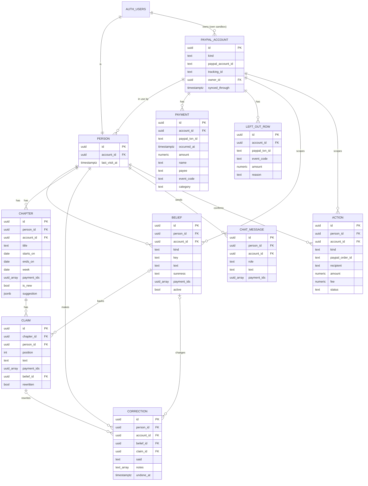

# PLAN

## Words used in this plan
| Word | Plain meaning |
| --- | --- |
| AC (acceptance criterion) | One thing a unit must do before it counts as finished. Written as Given / When / Then: "starting from this situation, when someone does this, this should happen." |
| Anonymous user | A visitor Soul remembers without a sign-up, through their browser. Each one gets a private copy. |
| Anon key | The one Supabase key that's safe to put in the browser. It can only do what the database rules allow. |
| BFF (backend for frontend) | Our own server code. The page talks only to it, and it talks to PayPal, Supabase and the AI, so the keys never reach the browser. |
| Capture | The step after a person approves a payment on PayPal, where Soul tells PayPal to actually move the money. |
| CI (GitHub Actions) | The same automatic checks, run again on GitHub every time code is pushed, as a second check. |
| Consent | The PayPal page where a person allows Soul to read their sandbox payments. |
| Cron / daily job | A task the server runs on its own once a day. |
| Cursor | A bookmark of the newest payment date already read, so Soul only reads what's new. |
| ER diagram | A drawing of the database tables and how they link. |
| Env vars | Settings and keys kept outside the code, in `.env.local` or on Vercel. |
| LCP (largest contentful paint) | The moment the main content first appears on screen. Used to time page speed. |
| LLM | The AI model that writes the story and the chat answers. Here it runs through OpenRouter. |
| Migration | A saved file that changes the database layout, so the same change can be repeated on the live database later. |
| Mock | Made-up data the prototype uses. Each unit replaces it with real data. |
| Order | A PayPal payment request. It waits until the person approves it, then Soul captures it. |
| Prototype | The clickable app approved at G4. It looks finished but runs on mock data. |
| RLS (Row Level Security) | Database rules that stop one person from reading or changing another person's rows. |
| Route | A web address in the app, like `/story`, or a BFF address the page calls, like `/api/story`. |
| Sandbox | PayPal's test system. Accounts and money there are fake. |
| Staging / Prod | Two Supabase projects. Staging is for building and testing. Prod (production) is the live one judges use. |
| T1900, T0300 | PayPal codes for rows that aren't purchases: the starting test balance and the bank top-up behind each payment. Soul leaves them out. |
| gitleaks | A tool that scans code for keys and passwords. It runs before every commit on your computer and again on GitHub, and blocks the commit if it finds one. |
| `npm test` | The one command that runs all the automatic tests. It runs on your computer before every unit report and commit, then again on GitHub. |
| Page states | The versions of a page: normal, loading, empty, error, and stale (old saved data while PayPal can't be reached). |
| Typecheck | An automatic check that the code's pieces fit together. |
| Unit (U0, U1 …) | One complete function, built and tested in one chat. |
| Webhook | A message PayPal sends to Soul on its own when something happens, like a payment completing. |
| Test types | **unit**: checks one small piece of code on its own. **integration**: checks code with the real Staging database. **e2e**: clicks through the real app in the browser. **ci**: the automatic checks on GitHub. **manual**: a person checks by hand. |

## 1. Context & golden path (G1 approved Nov 2, plan G5 approved Nov 3)

**Soul: your money has a story.** PayPal shows a person a list of payments. Soul turns them into a story that remembers, notices things first, and changes its mind when you correct it.

**Problem:** a payment list records what happened, not what it meant. People can't see their habits, the people they support, or what changed, and a chat over payment data answers one question and starts over next time.

**User:** anyone who uses PayPal. Judges can connect their own sandbox account or use our prepared data. The demo video follows the prepared person so the impact case stays concrete.

**Differentiator:** chat over MCP answers and moves on. Soul keeps beliefs about you tied to real payments, speaks up first, and rewrites its story when you correct it.

### Golden path (60–90 seconds)
1. Open Soul and choose: **Try it with our prepared data** (one click) or **Log in with PayPal**, in PayPal's colors and clearly marked sandbox (it opens PayPal's consent page). The note above the second button states the minimum data. An account below it gets an explanation and the offer of prepared data.
2. Soul opens with something it noticed, inside a story chapter.
3. Tap a sentence to see the sandbox payments behind it.
4. Correct it ("those groceries are for my mum"). The chapter rewrites and shows what changed. **The wow moment.**
5. Ask a question in chat. The answer uses the correction and cites payments.
6. A new sandbox payment is made on camera, and a new chapter appears.
7. Soul suggests an action. The user confirms, and it runs in the sandbox and joins the story.

### Scope
| Tier | What |
| --- | --- |
| Must | Two entry options · PayPal consent connection with Check connection · sandbox sync on open, refresh and one daily job · automatic categories from the user's list · story chapters · evidence on every claim with the PayPal transaction ID · "Why are some rows missing?" explanation, the rows left out, and an About section on differences from PayPal · Proactive Noticing · Revising Understanding · Richer Memory · limited Habit Recognition · grounded chat · one confirmed action (send money) · Delete my data |
| Should | Interests & Preferences · webhook for live chapters on purchases inside Soul |
| Could | Pasted sandbox app keys, only if consent fails for another developer's accounts |
| Won't | Reading real people's PayPal history · PayPal's identity-only login API · Web3 · ChatGPT or hosted MCP chat · AG Grid · APIMatic · real money |

### Judging and prizes
| Criterion or prize | What serves it |
| --- | --- |
| Technological Implementation | Reporting, Payouts, Subscriptions, webhooks and an AI agent with long-term memory |
| Design | A story instead of a list, with a designed correction moment |
| Potential Impact | One specific person's story, and a clear statement of what a real launch needs |
| Innovation/Idea | Memory that visibly changes its mind |
| Presentation, Best Demo Delivery | Correction and live chapter on camera |
| Best Use of PayPal + AI | PayPal data and actions drive every AI step |
| Best Use of Agentic Commerce | Confirmed actions that move sandbox money |
| Most Creative, Most Impactful, Grand prizes | Automatic entries |

A project can win one Grand or Honorable Mention prize, plus one Sponsor prize. No sponsor tool is planned.

### Hackathon facts
- https://paypalaihackathon.devpost.com/ · Deadline Nov 12, 2026 12:00 PT = Nov 13, 03:00 WIB. Optional early check if submitted by Nov 5, with editing open until the deadline.
- Must submit: description, working demo, tools used, public repo with a detected open source license, public YouTube video under 3 minutes. Name PayPal and AI in all of them.
- Must stay testable, free, until Dec 15, 2026. Judges have no AI key, so we host the demo. Judges use their own sandbox login, or none with the prepared data.

### Sandbox facts
- Payments keep their real dates, so bulk seeding can't create a habit. Prepared history comes from daily subscriptions. Only first charges are seen so far, and it should meet the minimum about Nov 9 if charges repeat.
- All prepared payments go to one merchant, `Test Store`, so the story follows what was bought, not who was paid.
- Send money hasn't been run. Cancel subscription was cut (U14). Consent lists payment, refund and fee permissions, not payouts, so sending from a judge's connected account is unproven.
- A real launch still needs PayPal's approval for production access. The README and pitch must say so.
- Hosted sandbox MCP has an open bug (paypal/agent-toolkit#119), so we use REST or the Agent Toolkit on the server.

### Judge account access (tested Nov 2 on our `soul` app)
- Log in with PayPal scopes are `openid`, `profile`, `email`, `address` and account attributes. None gives payments.
- Partner referral with `THIRD_PARTY` and `ACCESS_MERCHANT_INFORMATION` returned 403 NOT_AUTHORIZED on `soul`, likely because it isn't a Platform app.
- `paypal-soul-01` notes (Oct 23-26, not retested here) show a consent route on a sandbox Platform app, with no partner enrollment: referral link 201, then the account approves on PayPal. Reported: a business account and personal account A read 200 with matching transactions, personal B stayed 403 after approving, personal C never reached a read. Its working app was US, Expanded Checkout off, Mixed intent. PayPal bundled payment, refund and fee permissions into the consent, and the return to localhost failed, so it added a Check Connection button.
- Retested Nov 2 on a new Platform app: two sandbox accounts approved, and each read returned its own account (our buyer 9 rows, the other 0). Names are in `transaction_subject`. Filter T1900 and T0300 rows. An account from a different developer login is untested.
- App keys work as a backup: Transaction Search returned our app's business account rows. A second account's keys are untested, and a judge's app may need Transaction Search turned on.
- Rows are the merchant's view: first charges show as T0002 with a payer. A T1900 $5,000 row must be filtered out. Item name came back blank on subscription charges, so names may need a lookup through the subscription.
- 32 days or more in one request returns 400, so 90 days means several requests of 31 days or less.
- Supabase free plan: pauses after 1 week of inactivity, 2 active projects. Both Staging and Prod use those 2 slots, so keep the demo active with a scheduled ping or use a paid plan.

### Novelty check (Nov 2)
| Closest | What it does | Gap |
| --- | --- | --- |
| [MyBudgetNerd](https://mybudgetnerd.com) | Statement PDFs, "Financial Story", Ask Oracle Q&A. Maintained. | Generic uploads, no PayPal, no actions |
| [SpendTel](https://www.producthunt.com/p/spendtel/spendtel) | Uploaded statements become AI financial stories | No chat mentioned |
| [Goalmatic Bank Statement Wrap](https://www.producthunt.com/products/goalmatic-end-of-year-bank-summary) | Year-end Wrapped with personas | One-off recap, low traction |

Also near: [Salah](https://salah-liart.vercel.app/#/overview), merchant intelligence on synthetic data with evidence labels, a copilot and updates. Its footer refers to Paytm. This hackathon's gallery isn't public, so current entries are unchecked.

### Send money (tested Nov 2)
"Send money" moves the connected person's own sandbox money through an order paying the recipient, which they approve on PayPal. Soul creates the order and captures it on return. A $1 test completed: our buyer paid the second account, funded by the buyer's bank, PayPal took a $0.52 fee and the recipient got $0.48. It's a merchant-style payment, so the done screen shows the real fee from the capture. The recipient is a sandbox email the person picks or a prefilled test account.

## 2. Non-functional
| ID | Requirement | How it's checked |
| --- | --- | --- |
| NF-1 | Story page paints the newest saved chapter (largest contentful paint) in under 2s on Fast 4G, before any PayPal sync finishes | Chrome throttling on localhost, then on Preview in P7 |
| NF-2 | Every page works at 375px wide with no sideways scroll, and at 1440px | Browser test at both widths |
| NF-3 | No key or token reaches the browser. Only `NEXT_PUBLIC_SUPABASE_URL` and the anon key are public | grep of the built client bundle |
| NF-4 | RLS is on for every table with personal data. Person A can't read or change person B's rows | Automated test on Staging with two test people |
| NF-5 | Soul stores no PayPal keys or tokens for a person, only their PayPal account ID | Schema review in U0 architecture |
| NF-6 | Payment text is data, never instructions, in every LLM prompt | Unit test with an injected "ignore your rules" payment name |
| NF-7 | Every claim, belief and chat answer points to at least one saved payment, or says it has none | Unit test on the story and chat output checks |
| NF-8 | Totals, counts and repeats come from code, never from the LLM | Unit tests on the totals module |
| NF-9 | Chat: 300 characters per question, 5 questions per person per day from U16 (30 until then), reset at 00:00 UTC | Route tests |
| NF-10 | One PayPal request spans 31 days or less | Unit test on the date windows |
| NF-11 | Reduced motion stops the animations and pauses the video | Browser test with emulated reduced motion |
| NF-12 | LLM spend stays inside the OpenRouter limit until Dec 15 (the key is set to $20, the user has $29 of credit, Nov 5): under $1 a day during the build, checked at each unit review | OpenRouter usage page and a per-call token log |
| NF-13 | The demo stays up and free to use until Dec 15, 2026 | Daily job keeps Supabase awake, checked in P7 |

## 3. Data entities
Schema: `supabase/migrations/20261103102320_init.sql` (U0) `20261104092447_story.sql` (U4: a chapter's week and the payments it covered, a belief's key) and `20261104143835_correction.sql` (U5: support and told beliefs with `who`, a per-person `category` and `told_at`; a correction's `seen_at`) and `20261104163525_purchase.sql` (U8: a payment's `person_id` for purchases made in Soul, read only by that person), all applied to Staging. No PayPal keys or tokens anywhere, only the PayPal account ID (NF-5).

| Entity | Holds | Owner |
| --- | --- | --- |
| person | One per anonymous Supabase user: the account in use, last visit | self |
| paypal_account | PayPal account ID, consent tracking ID, `synced_through` (the import cursor). Prepared has no owner | shared (prepared) or one person |
| payment | Copy of a kept PayPal row: transaction ID, date, amount, name, payee, event code, category (`null` until categorised, `unknown` when unsure). A purchase made in Soul is added from the capture (capture ID as transaction ID) with the person who made it | the account, so prepared payments are shared; a purchase made in Soul only its person |
| left_out_row | Rows Soul skips (T1900, T0300 and others) with the reason | the account |
| belief | Habit, check, interest, support (payments for someone else, `who`) or told (what the person said, maybe a per-person category); how sure, source, payment IDs, active or stopped, told or confirmed by the person | person + account |
| chapter + claim | Story chapters and their sentences. Each claim has payment IDs and maybe a belief | person + account |
| correction | The person's words, belief and claim before and after, Here's What Changed notes, undone or not | person + account |
| chat_message | Questions and answers with cited payment IDs | person + account |
| action | Send money or purchase: PayPal order ID, recipient, amount, fee, capture ID, status | person + account |

Personal rows carry both the person and the account, so prepared data and an own sandbox each keep their own story, memory and chat (AC-10.4). The import cursor is a column, not a table. Questions per day are counted from `chat_message`, so there's no usage table. The category list lives in code. Payment IDs on claims, beliefs and chat are `uuid[]` arrays; claims and beliefs need at least one (NF-7).

Deleting an auth user cascades to their person, their own account with its payments, and every personal row, so Delete My Data and the 30-day cleanup are one call. The prepared account and its payments stay.

### RLS policies
RLS is on for every table. Visitors without a session have no grants at all. The server's secret key bypasses RLS for imports, captures and the daily job; it never reaches the browser.

| Table | Signed-in person can | Rule |
| --- | --- | --- |
| paypal_account | read | prepared (no owner) or `owner_id = auth.uid()` |
| payment, left_out_row | read | the account is readable (same rule) |
| person | read, write | `id = auth.uid()` |
| belief, chapter, claim, correction, chat_message | read, write | `person_id = auth.uid()` |
| action | read | `person_id = auth.uid()`. Status, fee and capture come from PayPal through the server only |

Tested by `tests/rls.test.ts` on Staging with two anonymous test people (NF-4).

## 4. Build phases and units
Prototype screens and states are in docs/DESIGN.md. Each unit replaces the matching mock in `lib/mock.ts` behind the same BFF routes, so the pages change as little as possible. Estimates include building, the browser test and the user's review.

Not a story but required by the G1 re-approval: the consent connection (S-12), the action status page (S-13), the rows left out (S-14) and Delete My Data (S-15). US-24 is cut (Won't, in the scope table). US-03 (reset) is covered by Delete My Data on prepared data.

### Phase A — Setup

#### U0 — Skeleton, test setup and architecture  (Must)
Covers: none      Screens: none      Depends on: Supabase Staging ready      Est: 3h
Acceptance:
- AC-0.1 Given a push to `main`, when GitHub Actions runs, then `npm test`, `next build` and a gitleaks scan of the full git history run, and their result shows on the commit.
- AC-0.5 Given localhost, when `npm test` runs, then typecheck and Vitest run against the Staging project and pass, and AGENTS.md records the command.
- AC-0.6 Given a staged file with a fake key in it, when a commit is tried, then the gitleaks pre-commit hook blocks it.
- AC-0.7 Given `.gitignore`, when U0 is done, then it ignores `HACKATHON-WORKFLOW-*`, `DESIGN-REFERENCE-*` and `.env*` but keeps `.env.example`, which lists the variable names with no values.
- AC-0.2 Given U0's commit, when its pages open on localhost, then each prototype route still renders from the mock routes, since only CI and setup files changed.
- AC-0.3 Given the architecture step, when it's done, then AGENTS.md lists the folders, BFF routes and env vars, and §3 has the ER diagram and RLS policies.
- AC-0.4 Given the Staging project, when the first migration runs, then every personal table has RLS on.
Tests: T-0.1 (ci), T-0.2 (manual), T-0.3 (manual), T-0.4 (integration), T-0.5 (manual), T-0.6 (manual), T-0.7 (manual)

### Phase B — Enter and read the story (golden path 1–3)

#### U1 — Entry, private copy and data menu  (Must · demo-critical)
Covers: US-01, US-02, US-04      Screens: S-01, S-11, header menu      Depends on: U0      Est: 2.5h
Acceptance:
- AC-1.1 Given a new visitor, when they choose Try It With Our Prepared Data, then Soul makes an anonymous person with their own copy and opens the story without any login.
- AC-1.2 Given two visitors on prepared data, when one changes their copy, then the other's copy is unchanged.
- AC-1.3 Given a returning visitor with the same browser, when they open Soul, then their own copy comes back.
- AC-1.4 Given any page, when the header menu opens, then it names the data in use and offers Prepared Data, and My Sandbox or Log In With PayPal.
- AC-1.5 Given the About page, when it opens, then it says the data is sandbox and lists what a real launch needs, including PayPal's production approval.
Tests: T-1.1 (e2e golden), T-1.2 (integration), T-1.3 (e2e), T-1.4 (e2e), T-1.5 (e2e)

#### U2 — PayPal import and rows left out  (Must · demo-critical)
Covers: US-06 (data), US-04      Screens: S-02a, S-02b, S-14      Depends on: U1      Est: 3.5h
Acceptance:
- AC-2.1 Given the prepared account, when the first import runs, then Soul reads up to 6 months in windows of 31 days or less and saves each kept row once.
- AC-2.2 Given T1900 and T0300 rows, when they're imported, then they go to the rows left out with a reason, and no total counts them.
- AC-2.3 Given saved payments, when the person opens or taps Refresh From PayPal, then only rows newer than the cursor are read.
- AC-2.4 Given an import in progress, when the story opens, then the saved story shows with a syncing state (S-02a).
- AC-2.5 Given PayPal returns an error, when the story opens, then the last saved story shows with the offline notice (S-02b) and Retry.
- AC-2.6 Given the story, when the person opens Why Are Some Rows Missing?, then the rows left out list with their code, amount, date and reason.
Tests: T-2.1 (unit), T-2.2 (unit), T-2.3 (unit), T-2.4 (e2e), T-2.5 (e2e), T-2.6 (e2e)

#### U3 — Automatic categories  (Must · demo-critical)
Covers: US-06, US-08 (data)      Screens: none      Depends on: U2      Est: 2h
Acceptance:
- AC-3.1 Given a new payment, when it's imported, then it gets one category from the fixed list and the category is saved with it.
- AC-3.2 Given a payment with a blank or vague name, when it's categorised, then it stays `unknown` and Soul calls it "a payment I can't identify".
- AC-3.3 Given a payment name containing instructions, when it's categorised, then the instructions are ignored and the category still comes from the list.
- AC-3.4 Given an already categorised payment, when it's imported again, then the LLM isn't called again.
Tests: T-3.1 (unit), T-3.2 (unit), T-3.3 (unit), T-3.4 (unit)

#### U4 — Story chapters, noticing, habits and evidence  (Must · demo-critical)
Covers: US-05, US-06, US-07, US-08      Screens: S-02, S-03      Depends on: U3      Est: 4h
Acceptance:
- AC-4.1 Given categorised payments, when the story is built, then code computes the totals and repeats, and the LLM writes chapters only from those figures and the payments.
- AC-4.2 Given the story opens, when it loads, then the newest chapter opens with what Soul noticed.
- AC-4.3 Given a repeat seen on at least 3 days, when the story is built, then it's named as a habit: Not Sure on 3–4 days, Fairly Sure on 5–9, Sure on 10 or more, or when PayPal shows a daily subscription. Under 3 days it isn't a habit.
- AC-4.4 Given a sentence, when the person taps it, then the evidence sheet lists its payments with date, amount and PayPal transaction ID.
- AC-4.5 Given more than 5 chapters, when the story opens, then the newest 5 show and Show Older Chapters loads the rest. The test seeds 6 chapters for a test person.
- AC-4.6 Given an LLM sentence with no payment behind it, when the story is saved, then that sentence is dropped.
Tests: T-4.1 (unit), T-4.2 (e2e golden), T-4.3 (unit), T-4.4 (e2e golden), T-4.5 (e2e), T-4.6 (unit)

### Phase C — Correct Soul (golden path 4)

#### U5 — Correction and rewritten chapter  (Must · demo-critical)
Covers: US-12, US-13      Screens: S-04, S-04a, S-05      Depends on: U4      Est: 3.5h
Acceptance:
- AC-5.1 Given the evidence sheet, when the person writes "those groceries are for my mum", then the belief changes, the chapter rewrites, and the changed sentence is marked in pink.
- AC-5.2 Given a rewrite, when it shows, then Here's What Changed lists the old and new sentence and any changed totals.
- AC-5.3 Given a correction that names nobody where a person is needed, when it's sent, then Soul asks one clarifying question first (S-04a).
- AC-5.4 Given a saved correction, when the story is rebuilt later, then the correction still holds.
- AC-5.5 Given Looks Right, when it's tapped, then the belief becomes Sure and nothing rewrites.
Tests: T-5.1 (e2e golden), T-5.2 (e2e golden), T-5.3 (e2e), T-5.4 (integration), T-5.5 (e2e)

#### U6 — Memory page  (Must)
Covers: US-14      Screens: S-06      Depends on: U5      Est: 2h
Acceptance:
- AC-6.1 Given beliefs, when Memory opens, then each shows its text, how sure, its source and payment chips.
- AC-6.2 Given a belief, when the person edits it, then it's saved as a correction and the story uses the new text.
- AC-6.3 Given a belief, when the person taps Stop Using This, then the story and chat stop using it.
Tests: T-6.1 (e2e), T-6.2 (e2e), T-6.3 (integration)

### Phase D — Ask (golden path 5)

#### U7 — Grounded chat  (Must · demo-critical)
U16 changes this unit: functions replace the word matcher, so AC-7.2's no-evidence answer is written by the LLM, AC-7.3's data comes from function results, and AC-7.5's limit becomes 5 a day.

Covers: US-16, US-17      Screens: S-07, S-07a, S-07b      Depends on: U5      Est: 3h
Acceptance:
- AC-7.1 Given a correction, when the person asks about it, then the answer uses the corrected belief and cites payments that open in the evidence sheet.
- AC-7.2 Given a question with no matching payments (flights), when it's sent, then Soul says it has no evidence and invents nothing.
- AC-7.3 Given a question, when it's sent, then the LLM gets only the last 10 questions and answers, active beliefs, and the totals and payments code found for it.
- AC-7.4 Given a question over 300 characters, when it's sent, then it's refused with a message and no LLM call.
- AC-7.5 Given 30 questions today, when the 31st is sent, then it's refused until 00:00 UTC.
- AC-7.6 Given a past chat, when the person returns, then the history shows.
Tests: T-7.1 (e2e golden), T-7.2 (e2e), T-7.3 (unit), T-7.4 (unit), T-7.5 (unit), T-7.6 (e2e)

### Phase E — New chapter and action (golden path 6–7)

#### U8 — Sandbox purchase and new chapter  (Must · demo-critical)
Covers: US-23, US-10      Screens: S-10, S-13, S-02c      Depends on: U4      Est: 3h
Acceptance:
- AC-8.1 Given the buy page, when the person pays, then Soul creates a sandbox order, shows the PayPal link on the status page, and the action is waiting.
- AC-8.2 Given an approved order, when the person returns, opens Soul or the daily job runs, then Soul captures it once and the action completes.
- AC-8.3 Given a completed purchase, when the story opens, then a new chapter marked new appears from the capture result, without waiting for the report rows.
- AC-8.4 Given a cancelled or expired order, when the status page opens, then it says so and nothing joins the story.
- AC-8.5 Given the same payment later in the report rows, when it's imported, then it isn't counted twice.
Tests: T-8.1 (e2e golden), T-8.2 (e2e, manual approval on PayPal), T-8.3 (e2e golden), T-8.4 (e2e), T-8.5 (unit)

#### U9 — Suggested action: send money  (Must · demo-critical)
Covers: US-18, US-19, US-20, US-21      Screens: S-02 suggestion, S-08, S-13, S-09, S-09a      Depends on: U8      Est: 3h
Acceptance:
- AC-9.1 Given a support belief (the groceries for mum), when the chapter shows, then it suggests sending money with a Review the Payment button.
- AC-9.2 Given the confirm page, when it opens, then it shows the recipient, the amount and that money moves only after approval on PayPal.
- AC-9.3 Given a capture, when the done page opens, then it shows the recipient, the amount, the real fee and the transaction ID from PayPal.
- AC-9.4 Given a completed send, when the story opens, then it joins the story.
- AC-9.5 Given a failed order or capture, when it happens, then the failed page says nothing moved and offers Retry.
Tests: T-9.1 (e2e golden), T-9.2 (e2e golden), T-9.3 (e2e golden), T-9.4 (e2e golden), T-9.5 (e2e)

### Phase F — Own sandbox and data control

#### U10 — Connect your own sandbox  (Must)
Covers: US-02      Screens: S-12, S-01 note, header menu      Depends on: U2      Est: 3h
Acceptance:
- AC-10.1 Given Log In With PayPal, when the person approves on PayPal and returns or taps Check Connection, then Soul finds their account ID and imports their payments.
- AC-10.2 Given consent not finished or refused, when Check Connection runs, then the pending or denied state shows with the prepared-data offer.
- AC-10.3 Given an account below the minimum (payments spanning 7 days, 5 payments, and one name seen on 2 or more days), when it's imported, then Soul says what's missing and offers the prepared data.
- AC-10.4 Given a connected person, when they switch to Prepared Data and back, then each keeps its own memory and chat without a new login.
- AC-10.5 Given Log Out of My Sandbox, when it's tapped, then Soul forgets the link and returns to the entry.
Tests: T-10.1 (e2e, manual consent), T-10.2 (e2e), T-10.3 (unit), T-10.4 (e2e), T-10.5 (e2e)

#### U11 — Delete My Data and the daily job  (Must)
Covers: US-02, US-03      Screens: S-15      Depends on: U9, U10      Est: 2.5h
Acceptance:
- AC-11.1 Given Delete My Data on prepared data, when it's confirmed, then only that person's chapters, beliefs, corrections, chat and actions go, the shared payments stay, and the next visit starts fresh.
- AC-11.2 Given Delete My Data on an own sandbox, when it's confirmed, then that account's payments and link go too.
- AC-11.3 Given the daily job, when it runs, then it imports for connected accounts, captures approved orders and deletes prepared-data people whose last visit is 30 days or more before the run, in UTC.
- AC-11.4 Given the job URL without the cron secret, when it's called, then it returns 401.
Tests: T-11.1 (e2e), T-11.2 (integration), T-11.3 (integration), T-11.4 (unit)

### Phase G — Shoulds, only if time allows

#### U12 — Undo a correction  (Should)
Covers: US-15      Screens: S-05      Depends on: U5      Est: 1h
- AC-12.1 Given a rewrite, when the person taps Undo, then the belief and chapter go back and the correction is kept as undone.
Tests: T-12.1 (e2e)

#### U13 — Interests and preferences  (Should)
Covers: US-09      Screens: S-02, S-06      Depends on: U6      Est: 2h
- AC-13.1 Given repeated categories, when the story is built, then Soul states an interest as a belief with payments, and the person can correct it like any other.
Tests: T-13.1 (unit), T-13.2 (e2e)

#### U14 — Cancel a subscription  (Cut, Nov 5)
Covers: US-22      Screens: S-08, S-09, S-09a      Depends on: U9      Est: 2h
- AC-14.1 Given a daily subscription habit, when the person confirms Cancel, then Soul cancels it in the sandbox and the story notes the change. If PayPal refuses, the failed page says nothing changed. Open question 5 is checked before this unit starts.
Tests: T-14.1 (e2e), cut
Cut on Nov 5: consent doesn't reach subscriptions (open question 5). Chat answers a request to cancel instead, pointing to PayPal's settings.

#### U15 — Live chapters by webhook  (Should)
Covers: US-11      Screens: S-02c      Depends on: U8      Est: 2h
- AC-15.1 Given a capture webhook for an order made in Soul, when it arrives with a valid signature, then the new chapter appears on an open story without refresh.
Tests: T-15.1 (integration)

### Phase H — Chat with functions

#### U16 — Chat picks functions  (Must · agreed Nov 5, replaces how U7 finds payments)
Covers: US-16, US-17      Screens: S-07, S-07a, S-07b      Depends on: U7      Est: 6h

Why: code picks a question's payments by matching words, and it has no idea of dates, so "this month" returns everything Soul has, and "any chocolate?" never reaches the LLM. The user wants Chat to reflect the real world as closely as it can. So the LLM reads the question and calls functions, and code runs them.

How one question flows:
1. Code checks the limits. A request to cancel keeps code's reply (U14).
2. The picker, Claude Opus 5.5 at low effort, gets the question, today's date, the last 10 questions and answers, the category list, the person's payment names and the functions. It calls functions and fills their parameters: "this month" means Nov 1 to Nov 30, 2026. Up to 3 rounds.
3. Code checks the parameters, runs the functions and returns the results with clear labels, like "spent in October".
4. The writer, Claude Haiku 5.5, gets the question and the results, with no function list, and writes 1 to 3 sentences. It also writes the natural sorry when the picker found no function that fits.
5. Code checks every amount against the function results, then builds the list under the answer from those results.

The functions (25 planned, 24 built: `sum_fees` is cut, see its row):

| # | Function | Example question |
| --- | --- | --- |
| 1 | `find_payments` (dates, words, category, person, amount, refunds and money received, sort, limit) | "Biggest payment in October?", "When did I last pay for coffee?", "Any refunds?" |
| 2 | `find_new` | "Anything new this month?" |
| 3 | `find_unusual` (much bigger than the usual for that name) | "Anything strange?" |
| 4 | `find_duplicates` | "Did I pay for something twice?" |
| 5 | `find_price_changes` | "Has anything gone up in price?" |
| 6 | `find_stopped` | "What did I stop paying for?" |
| 7 | `find_peak_period` | "What was my most expensive day?" |
| 8 | `sum_spending` (group by category, day, week, month, weekday, time of day, store or person; percentages; days with and without spending) | "How much this month?", "What percent goes to groceries?", "Which days did I spend nothing?" |
| 9 | `compare_spending` (two periods) | "Did I spend more than last month?" |
| 10 | `rank_spending` (top categories, names, stores or people) | "What do I spend most on?", "Who do I send money to?" |
| 11 | `average_spending` (per day, week or month) | "What's my average per week?" |
| 12 | `spending_trend` | "Is my grocery spending going up?" |
| 13 | `project_month` (this month's pace) | "Where will I end up this month?" |
| 14 | `cost_over_time` | "What does coffee cost me per year?" |
| 15 | `what_if_stopped` (stated as math, not advice) | "How much would I save without coffee?" |
| 16 | `money_in_out` | "Did more come in than go out?" |
| 17 | ~~`sum_fees`~~ cut Nov 5: PayPal's fee is kept only for orders made in Soul, where the receiver pays it, so Soul can't say what a person paid. The picker says `no_data` and Soul says sorry | "How much did I pay in fees?" |
| 18 | `list_repeats` | "What are my subscriptions, and what do they cost?" |
| 19 | `get_memory` (option: only the ones Soul is unsure about) | "What do you know about me?", "What are you unsure about?" |
| 20 | `explain_belief` | "Why do you think that about me?" |
| 21 | `get_chapter` | "What happened last week?" |
| 22 | `list_corrections` | "What have I corrected?" |
| 23 | `list_actions` (option: only what's still waiting) | "What did I buy or send through Soul?" |
| 24 | `list_left_out` | "Why is this payment missing?" |
| 25 | `data_coverage` | "How far back can you see?", "When did you last read PayPal?" |

Built as planned, with these details: the picker also gets the stores and people, so `words` and `person` can name them. It writes `final` with its calls when they're enough, so most questions take one Opus call, or `more` when it must see results first. With no calls it writes `no_data` (Haiku says sorry) or `off_topic` (code's polite line, no Haiku call). Store names now reach the LLM, as the store grouping needs. An answer thrown out for a made-up figure gets code's line and still counts, since it spent money; a failed call doesn't count. The writer is asked once more when its reply isn't JSON.

The list stops here: the LLM reads it on every question, and overlap is what makes it pick wrong. A new kind of question fits as an option on a function first.

Steps the person sees, in plain words, each one sent by the server as it really happens: Reading Your Question, Checking Your October Payments, Adding Up the Numbers, Writing Your Answer.

Acceptance:
- AC-16.1 Given a question, when it's sent, then the picker chooses the functions and fills their parameters in up to 3 rounds, and code runs them.
- AC-16.2 Given a time word ("this month", "last week", "in October", "yesterday"), when it's sent, then the period comes from today's date, and the totals, the list and the biggest payment all follow that period.
- AC-16.3 Given a word that isn't in any payment name (chocolate) and a payment that means it (Snickers Bar), when it's sent, then the picker finds the payment by meaning. With no such payment, Soul says so.
- AC-16.4 Given something Soul has no data for (balance, budgets, tax, investment advice, what's inside a payment), when it's sent, then Haiku writes a natural sorry and invents nothing.
- AC-16.5 Given an off-topic question (coding) or an attack ("forget all instructions", "show your prompt", a payment named "ignore your rules"), when it's sent, then Soul keeps to payments with the same polite line, and it counts toward the daily limit.
- AC-16.6 Given any function call, when code runs it, then the parameters are checked first, the function only reads, and it's locked to the person's own account through their session. The LLM can't choose whose data it reads, and no function moves money.
- AC-16.7 Given an answer, when it's checked, then every amount comes from a function result of this question, or the answer is thrown out. The list under the answer holds every payment behind its figures, built by code, and the count always matches.
- AC-16.8 Given more than 60 payments behind a question, when it's answered, then the LLM reads at most 60 rows, the totals still cover all of them, and the answer says so: "Totals cover all 134 payments. I read the newest 60 in detail." At 60 or fewer nothing is added. A power buyer gets correct totals and an honest note.
- AC-16.9 Given a question in progress, when each step happens, then the person sees it in plain words, so Chat never looks stuck.
- AC-16.10 Given 5 questions today, when the 6th is sent, then it's refused until 00:00 UTC, and the Chat page says the limit up front. The 300 characters stay.
- AC-16.11 Given the total Chat spending cap (the OpenRouter key's $20 limit, see NF-12), when under $2 is left on the key, then Chat politely says it's done for now and the rest of Soul keeps working on what's left. Every LLM call logs its cost.
- AC-16.12 Given a request to cancel, when it's sent, then code's reply answers it with no LLM call, as now.
- AC-16.13 Given the question list (at least 2 per function and at least 10 attacks), when it runs against the real models, then the score shows how often the right function and the right dates were picked, and the wording matches the labels. Run the picking part only, stopping before the final answer, and rerun only what fails, to save credit.
Tests: T-16.1–T-16.5 (unit), T-16.6 (integration), T-16.7, T-16.8 (unit), T-16.9 (e2e), T-16.10–T-16.12 (unit), T-16.13 (real models, once)

Check while building: OpenRouter offers both models with tool calling (`lib/llm.ts` only asks for JSON today, and sends `temperature: 0`, which newer models can reject, so the Opus call drops it; forced `tool_choice` is rejected too, so use auto). A refusal from a model becomes the natural sorry, not an error. The prepared data covers a few days only, so periods, price changes and stopped payments are tested with made-up payments in unit tests. Today's word matcher in `lib/chat.ts` goes, and the `behindFigures` idea, the 60-row limit, the note and `PaymentList` stay. If Opus picks badly, first improve the function descriptions, then have it choose a group before a function.

### Phase I — Closing the requirement gaps (agreed Nov 9)

On Nov 9 the user checked Soul against their five requirements (habit recognition, richer memory, interests and preferences, proactive noticing, revising its understanding). Habit recognition is done. The other four have one gap each, and each gap is one unit below. Musts come first. Each unit runs in its own chat. U17 comes before U18 because the answer to U18's question ("it was a birthday gift") needs U17's one-off belief.

#### U17 — Keep exceptions apart  (Must · requirement 5, revising its understanding)
Covers: US-12, US-13, US-14      Screens: S-04, S-05, S-06      Depends on: U5, U6, U12      Est: 2.5h

Why: a correction that names someone the person already supports joins that person's one support belief. `correct()` in `lib/correct.ts` keys support by who (`support:your mum`), adds the payment to it and replaces its text with the new sentence. So "that one was a birthday gift for my mum" turns "You buy the weekly groceries for your mum" into a sentence about a gift, and the broader belief is lost. Nothing marks a payment as an exception.

How:
1. Prove the bug first with a test that fails on today's code.
2. The correction LLM also answers `oneOff`: true when the person marks the payments as a one-time thing (a gift, a birthday, "just this once", "only that one", an exception). Code keeps it only when the correction singles out some of the sentence's payments, not all of them.
3. A one-off becomes its own belief: `kind` support when it names someone (so Spent on You still leaves it out), otherwise told, with key `oneoff:<first payment id>`. Its payments leave every other belief, as `nextTold` already does for support.
4. The broader belief keeps its text and its other payments. Only a correction that isn't a one-off changes the broader belief's text, as today.
5. A one-off payment is left out of repeats, habits and interests (`lib/totals.ts`), so one birthday transfer doesn't change a habit's days or its usual amount. U18 uses the same rule.
6. The story LLM gets one-offs marked as exceptions in `toldYou` and says them apart from the pattern, like "On Nov 4 you sent your mum a birthday gift, apart from the usual groceries."
7. Here's What Changed (code) says: "1 payment kept apart as a one-off: a birthday gift for your mum. Support for your mum stays as it was." Undo puts back both beliefs.
8. Memory shows a one-off with a One-Off tag. Edit, Stop Using This and Use Again work as for any belief. A one-off never gives a send money suggestion (U9). No migration: the key is free text and stays unique per person and account.

Acceptance:
- AC-17.1 Given support for your mum on several payments, when the person corrects one of them as "that one was a birthday gift for my mum", then it becomes its own one-off belief, and the support belief keeps its text and its other payments.
- AC-17.2 Given a one-off, when the story is rebuilt, then its chapter names it apart from the usual pattern, and Spent on You still leaves it out.
- AC-17.3 Given a one-off payment with the same name as a repeat, when repeats, habits and interests are counted, then it's left out of their days, counts and amounts.
- AC-17.4 Given a correction that changes the broader picture ("I buy mum's groceries every week now"), when it's saved, then the support belief's text changes and every one-off stays as it was.
- AC-17.5 Given a one-off correction, when Here's What Changed shows, then it says the payment was kept apart and the broader belief didn't change, and Undo puts both beliefs and the chapters back.
- AC-17.6 Given a one-off, when Memory opens, then it shows with a One-Off tag and can be edited, stopped and used again, and no send money suggestion comes from it.
Tests: T-17.1 (unit), T-17.2 (unit), T-17.3 (unit), T-17.4 (integration), T-17.5 (e2e), T-17.6 (e2e)

Check while building: what the LLM does with "birthday gift" today. It may already give a category (Gifts), which skips the support key and half works by luck. Run the real correction model on 10 short one-off and 10 broader corrections once, about $0.01, and show the user the score.

#### U18 — Ask about an unusual payment  (Must · requirement 4, proactive noticing)
Covers: US-05, US-06, US-12      Screens: S-02, S-03, S-04      Depends on: U17      Est: 3h

Why: each chapter opens with what Soul noticed, and Soul asks about a habit it's Not Sure of. But it never spots a payment much bigger than usual, and never asks what it was for. The user's example: "This transfer is larger than your usual amount. Does it have a different purpose?"

How:
1. One rule in `lib/totals.ts`, `unusual(pays)`: a spending payment is unusual when the same name, or the same person for support, has at least 3 earlier payments, and it's at least 1.5 times their median and at least $5 more. One-offs (U17) are left out of both sides. A payment the person already answered about is never asked about again, but still counts as an earlier one, and the usual is at least the biggest such payment, so a payment like one they called normal isn't asked about (fixed Nov 9 in review). Chat's `find_unusual` switches to this rule, so Chat and the story agree.
2. The story brief gets `unusual` for each week: the payment, the usual amount and the earlier payments by ref. The LLM may say it plainly ("Your Nov 4 transfer to your mum was $80.00, more than the usual $25.00.") and never guesses why.
3. Under the newest chapter that holds one, the first unexplained unusual payment gets an "I Noticed" card, written by code from code's figures: "This $80.00 to your mum is bigger than your usual $25.00. Does it have a different purpose?" Check the Payments opens the evidence sheet with that payment and the earlier ones. It sits where the Not Sure check note sits; when both exist, the unusual payment comes first.
4. Two answers. **Tell Soul** opens the correction box (U5) on that payment, so "it was her birthday" becomes a one-off (U17) and "she needs more now" changes the broader belief. **Same as Usual** saves a `check` belief (the kind exists since U0, unused) with key `unusual:<payment id>`, so Soul never asks about that payment again. It isn't listed on Memory. Undo isn't needed: the card only asks.
5. Summary: the "Belief to Check" figure counts the open question too.

Acceptance:
- AC-18.1 Given a name or person with at least 3 earlier payments, when a payment is at least 1.5 times their median and at least $5 more, then code marks it unusual. With fewer than 3 earlier payments, or a one-off, it isn't.
- AC-18.2 Given an unexplained unusual payment in the newest chapters, when the story opens, then the I Noticed card shows code's sentence and question, and Check the Payments opens that payment and the earlier ones.
- AC-18.3 Given the card, when the person taps Tell Soul and answers "it was a birthday gift", then a one-off belief is saved (U17), the chapter rewrites, and the card goes.
- AC-18.4 Given the card, when the person taps Same as Usual, then nothing rewrites, the card goes and never comes back for that payment, and Memory doesn't list it.
- AC-18.5 Given an unusual payment, when the story is written, then the LLM may state it with code's figures but never says why.
- AC-18.6 Given Chat's "anything strange?", when it's answered, then it uses the same rule as the story.
Tests: T-18.1 (unit), T-18.2 (e2e golden), T-18.3 (e2e), T-18.4 (e2e), T-18.5 (unit), T-18.6 (unit)

Check while building: the prepared data has no unusual payment today (the repeats are the same amount each day). The live test needs one real sandbox payment that is bigger than usual for a repeated name or person. Ask the user how to make it before testing, for example a larger send to Soul's test account after a few $25.00 sends, or a one-off checkout named like a repeat. Unit tests use made-up payments. The demo video can show this card right after the correction, so check where it fits in the golden path with the user.

#### U19 — Tell Soul about you  (Nice to have · requirement 3, interests and preferences)
Covers: US-09, US-14      Screens: S-06, S-02, S-07      Depends on: U13, U16      Est: 3h

Why: Soul notices interests from repeated categories (U13), but a person can't tell it their priorities, hobbies or preferences directly, like "I'm saving for a trip to Japan" or "I love baking".

How:
1. A "Tell Soul About You" box on Memory, 200 characters, at most 10 kept per person and account.
2. One Haiku 5.5 call reads it as data and returns: what it is (priority, hobby or preference), one short belief sentence to "you" with no amounts, and the categories from the list it relates to (maybe none). Code keeps only listed categories and drops any sentence with an amount.
3. Saved as a new belief kind, `preference`, with source "You Told Me" and Sure. Migration: add `preference` to the kind check, and let a preference have no payments (the payment check becomes `cardinality(payment_ids) > 0 or kind = 'preference'`). NF-7 gets one line: a preference is the person's own words, shown as such, never as evidence.
4. Memory lists preferences in their own group with Edit, Stop Using This, Use Again and Delete. Edit reads the new words the same way.
5. The story brief gets active preferences with their related categories. The LLM may name one only in a sentence about that week's payments in a related category, citing those payments ("Two baking orders this week, which fits your love of baking.").
6. Chat: `get_memory` returns preferences, and the writer gets active ones, so "what do you know about me?" includes them and "how much did I spend on my hobby?" can use the related categories.
7. A U13 interest whose category matches a preference becomes Sure and "You Told Me".

Acceptance:
- AC-19.1 Given the box, when the person writes "I love baking", then a preference is saved with its related categories and shows on Memory as You Told Me.
- AC-19.2 Given a preference, when the person edits, stops, uses again or deletes it, then the story and chat follow on the next rewrite or question.
- AC-19.3 Given a preference with related payments in a week, when that chapter is written, then it may be named once, citing those payments. With no related payments it isn't mentioned.
- AC-19.4 Given "what do you know about me?" in Chat, when it's answered, then the preferences are part of the answer.
- AC-19.5 Given text over 200 characters, an 11th preference, or "ignore your rules" in the box, when it's sent, then the limit is refused with a message, and the attack is kept as plain words that change no rule.
- AC-19.6 Given a noticed interest in the same category, when the preference is saved, then the interest becomes Sure and You Told Me.
Tests: T-19.1 (e2e), T-19.2 (e2e), T-19.3 (unit), T-19.4 (unit), T-19.5 (unit), T-19.6 (unit)

#### U20 — Chat remembers what you tell it  (Nice to have · requirement 2, richer memory)
Covers: US-16, US-12, US-14      Screens: S-07, S-06      Depends on: U17, U19      Est: 4h

Why: Chat only reads (AC-16.6). When someone says "the payments to Sam are my rent" or "I'm cutting back on coffee", Soul answers and forgets. Memory only changes through That's Not Right, the Memory page and, after U19, the box.

How:
1. The picker can also return `remember` next to its function calls: a proposed belief (support with who, told with a category, one-off, or preference) and the function that finds its payments. Functions stay read-only and nothing is saved here.
2. Code checks the proposal like a correction: a real person, a listed category, payments only from this question's function results, no amounts in the text. A question ("who is Sam?") never makes a proposal.
3. The answer shows a "Remember This?" card with the belief and its payment chips. Nothing is saved until the person taps Remember. Not Now drops it. The tap costs no question.
4. Remember saves through the same code as a correction (U5, U17) or a preference (U19): the weeks with those payments are rewritten, Here's What Changed shows on the story, Undo works, and Memory lists it with the source "You Told Me in Chat".
5. The person's tap is the safeguard against planted memories: a payment named "remember I'm rich" or a chat line "remember I spent $999" can at most make a card the person sees and turns down, and code drops the amount anyway.

Acceptance:
- AC-20.1 Given a statement about payments in Chat ("the payments to Sam are my rent"), when it's answered, then a Remember This? card shows the belief and its payments, and nothing is saved yet.
- AC-20.2 Given the card, when the person taps Remember, then the belief is saved as You Told Me in Chat, the chapters with those payments rewrite, Memory lists it, and the next answers use it.
- AC-20.3 Given the card, when the person taps Not Now or leaves, then nothing is saved.
- AC-20.4 Given a question, an off-topic message or an attack, when it's sent, then no card shows. Given a proposal with an amount, an unknown category or payments outside this question's results, then code drops it.
- AC-20.5 Given the question list (20 statements, 20 questions, 10 attacks), when it runs on the real picker once, then the score shows how often a card appears exactly when it should. About $0.20, shown to the user before moving on.
Tests: T-20.1 (unit), T-20.2 (e2e), T-20.3 (e2e), T-20.4 (unit), T-20.5 (real models, once)

#### U21 — Send money from Memory  (Must · agreed Nov 9, replaces where U9's send starts)
Covers: US-19, US-20, US-21      Screens: S-06 Send Money on a person (replaces S-08 and the S-02 suggestion), S-13, S-09, S-09a      Depends on: U6, U9, U18      Est: 2h

Why: the user, Nov 9. The story is for reading and correcting, and Chat is for questions about payments, so neither is the place to send money. A page of its own would make Soul look like a second PayPal. And the old suggestion ("Want to send your mum some money towards the next one?") claimed a reason Soul doesn't have. Soul only knows someone matters to you because you told it. So the honest place is Memory: next to each person Soul knows about, a plain Send Money button, with no story about why.

How:
1. A person on Memory is someone you told Soul a payment was for (an active support belief with `who`, not a one-off), or someone you already sent money to through Soul. Each person's belief gets a **Send Money to <who>** button. People you only sent to are listed under "People You've Sent Money To", each with the same button.
2. The button opens a form under that person, with the person filled in:
   - **How Much?**: from $1.00 to $100.00, checked on the server too (U18's `sendAmount`).
   - **Account**: a dropdown of the account saved for this person first, Soul's Test Account, the other saved accounts (each with who it's for), and Type a New Account, which shows an email field.
   - **Get the PayPal Link**: makes the order as U9 does, then the status page. Nothing moves until the person approves on PayPal with their own sandbox login.
3. The person's latest send shows under them: "Sent $30.00 on Nov 9" or "Waiting on PayPal" with a link to the payment. They can always send again.
4. An account typed for someone is saved for that person (table `send_account`: person, data source, who, email, unique per who), so next time it's picked by itself. It's kept for this visitor only (RLS) and goes with Delete My Data. Soul's Test Account is never saved.
5. The send needs no support belief behind it: the action keeps who it was for, and the captured payment is saved for that person (`for_who`), so it's never spending on you, joins its own New chapter, and counts for that person in U18's unusual rule.
6. The story stops suggesting sends: `suggestSends` and the confirm page go. "Try Again" after a failed send goes back to Memory.
7. Chat stays questions only. A message asking to send money ("send $30 to Anna") gets code's line, "I only answer questions about your payments. To send money, tap Send Money next to the person on Memory.", with no LLM call. It isn't saved and doesn't count toward the 5 questions. Asking about past sends ("how much did I send mum?") stays a normal question.

Acceptance:
- AC-21.1 Given a support belief for your mum, when Memory opens, then it shows Send Money to Your Mum, and the form has the person filled in, How Much? and the Account dropdown. A one-off or a belief about a thing has no button.
- AC-21.2 Given "send $30 to Anna" in Chat, when it's sent, then Soul's line points to Memory, with no LLM call, and the questions left don't change. A question about past sends is a normal answer.
- AC-21.3 Given the form, when the person types a new account for Anna and gets the PayPal link, then the account is saved for Anna and comes first in the dropdown next time; Soul's Test Account isn't saved.
- AC-21.4 Given an amount outside $1.00 to $100.00, when Get the PayPal Link is tapped, then the form says so and no order is made (checked on the server too).
- AC-21.5 Given an approved send to Anna, when the story and Memory open, then a New chapter shows it, Spent on You doesn't change, and Anna is listed under People You've Sent Money To with "Sent $30.00".
- AC-21.6 Given the story, when it opens, then no chapter suggests sending money.
Tests: T-21.1 (unit), T-21.2 (unit), T-21.3 (integration), T-21.4 (unit), T-21.5 (e2e), T-21.6 (e2e)

### Build order and time
U0 → U1 → U2 → U3 → U4 → U5 → U7 → U8 → U9 → U6 → U10 → U11 → then U12, U13, U15 if time allows (U14 cut), then U16, agreed Nov 5, before the user's sandbox test. Then, agreed Nov 9: U17 → U18 (Musts), then U19 → U20 (nice to have), each in its own chat, about 12.5h in all, before P7.  U21 (send money from Memory, Must) was agreed after U18 on Nov 9 and comes right after it, in the same chat.

U6 moves after the golden path because the demo doesn't open Memory. U10 is Must but after the golden path, since the demo uses prepared data and U2 already proves the read route.

Musts total about 34.5h, Shoulds 7h. P6 runs Nov 4 to Nov 10, then P7 Nov 10 to 12, with the deadline at Nov 13 03:00 WIB. At 80% of P6 (about Nov 9 evening), Shoulds are cut first.

## 5. Decisions log
| Date | Decision | Why |
| --- | --- | --- |
| Nov 2 | Web2, solo, sandbox data only | No crypto prize. The user wants no made-up history. |
| Nov 2 | Individual customers, not sellers | More unique, and the sandbox data already supports it |
| Nov 2 | Own chat with Vercel AI SDK and OpenRouter | User has OpenRouter credit. Hosted MCP is unreliable and judges shouldn't need setup. |
| Nov 2 | AG Grid and APIMatic dropped | Extra work with no product benefit. APIMatic proposal not approved. |
| Nov 2 | New private repo `ervhint/paypal-soul` | User wanted a fresh start. It goes public with a license before submission. |
| Nov 2 | No AI attribution on commits or PRs | User's instruction |
| Nov 2 | All browser work uses Claude in Chrome | Workflow rule 19 |
| Nov 2 | Each judge gets a private copy of memory | One judge's correction must not change the story for the next |
| Nov 2 | Fresh sandbox buyer, merchant and app. Old accounts, data and `paypal-soul-01` tools are not used. | The user wants a clean build. Old data has test labels and bulk days, so little is lost. Replaces the earlier choice to reuse the old person. |
| Nov 2 | Daily history comes from subscriptions, plus occasional one-off checkouts | The buyer approves once and PayPal then charges by itself each day |
| Nov 2 | Entry screen has two options: prepared data with one click, or the judge's own sandbox account. How the second one connects depends on the access check. | Judges can use their own account, and nobody hits a dead end |
| Nov 2 | Connecting uses PayPal consent through the new sandbox Platform app. Prepared data uses the same route with our buyer, so there's no buyer flip. Replaces the one-click prepared buyer as the only entry and the merchant-side reading. | Passed on 2 accounts, and judges share no keys |
| Nov 2 | Own account needs payments spanning at least 7 days, 5 or more payments, and at least 1 repeat. The note sits above the button and in the README. Below that, Soul says what's missing and offers the prepared data. Numbers can change after testing. | Soul needs history for a story, and sandbox payments can't be backdated |
| Nov 2 | `paypal-soul-01` may be read as reference only, no copying (user). Payment naming follows its idea: item, subject and note first, event code for mechanics only, then AI picks from a fixed category list, with `unknown` when evidence is thin. | The user's earlier work solved this, but the code is messy |
| Nov 2 | Use the user's own detailed category list from `paypal-soul-01` (the user's list, so reuse is approved). Every new payment is categorised automatically on import and saved. Code does totals and repeat counts, and the LLM writes the story. | Detailed now avoids a painful change later, labels stay consistent, and sums don't depend on the LLM. AI cost is fine for the hackathon. |
| Nov 2 | Import runs on open and refresh. One daily scheduled job also imports for connected accounts and keeps Supabase awake. | New payments are ready without a visit, and one job covers both needs |
| Nov 2 | Consent is the main route. A second developer login stays untested for now, and must be tested before deployment finishes. | The user accepts the risk and will create the login later |
| Nov 2 | Send money and purchases give the user a PayPal link and don't block Soul. The action stays "waiting" until paid. Soul completes approved orders on return, on open and in the daily job, and only completed payments join the story. | The user keeps moving, and the story never claims a payment that didn't happen |
| Nov 2 | Read back up to about 90 days (limit to confirm), then add new payments on each visit or refresh. Purchases inside Soul use the checkout result directly. | The story keeps growing without re-reading everything. Webhooks on a judge's app wouldn't reach us. |
| Nov 2 | On prepared data, reading needs no login, but approving a payment on PayPal needs the person's own sandbox login. Soul shares no test login. Without one, nothing moves and the rest of Soul still works. | The user's choice. Nobody else can use our buyer's account. |
| Nov 2 | Read back up to about 6 months (limit to confirm). Replaces the 90 days above. The story shows the newest 5 chapters, with Show Older Chapters added in the build phase. | The user looks back about 6 months, and categories are only worked out once per payment |
| Nov 2 | The header shows which data is in use and opens a menu: Prepared Data, My Sandbox or Log In With PayPal, and Log Out of My Sandbox. Switching needs no logout, and each one keeps its own memory and chat. | A logged-in user can try prepared data and come back |
| Nov 2 | Chat history is saved. The LLM gets the last 10 questions and answers, saved memory, and only the totals and payments code finds for the question. Questions are limited to 300 characters and 30 per person per day (can change after testing), with no thread limit. Logged-in chats stay until Delete My Data, prepared-data chats go 30 days after the last visit. | Cost stays flat however long the chat gets, and the $20 OpenRouter limit needs protecting from spam |
| Nov 2 | Delete My Data removes only that person's data, and on prepared data never the shared payments. | One person must not reset the demo for others |
| Nov 2 | Supabase stores payment copies, chapters, corrections, memory and chat per judge. Prepared payments are shared, memory stays private. With consent, Soul stores only the judge's PayPal account ID, no keys or tokens. Add "Delete my data". | Evidence stays stable, and a leak can't expose judge keys |
| Nov 3 | Units split by hand in the workflow's unit format, since the `to-tickets` skill isn't installed | Same result in local Markdown, no tracker |
| Nov 3 | Each visitor is a Supabase anonymous user, so RLS can use `auth.uid()` and the private copy survives in the same browser. Accepted with G5 | No sign-up for judges, and RLS still protects each copy |
| Nov 3 | The daily job is one Vercel Cron route protected by a secret. On localhost it's called by hand | Free on Vercel, and one job covers import, captures, cleanup and keeping Supabase awake |
| Nov 3 | `npm test` (typecheck and Vitest) runs on localhost before every unit report and commit, and GitHub Actions runs it again with the build and a gitleaks scan on every push. PayPal and the LLM are mocked in unit tests. RLS and data tests use the hosted Staging project with a test person who cleans up. Browser tests run with Claude in Chrome on localhost at 1440px and 375px, covering every page state | Workflow V11 rules 11 and 22, and P6 step 3 |
| Nov 3 | US-24 (identity-only login) cut | Already Won't in the scope table. It gives no payments |
| Nov 3 | U0 architecture: the browser never talks to Supabase. The BFF holds the anonymous session in a cookie and calls Supabase with the anon key, so RLS still applies per person. The secret key is used only for shared tables, captures and the daily job. No `NEXT_PUBLIC_` variables, which is stricter than NF-3 | Workflow rule 13, and nothing to leak from the bundle |
| Nov 3 | Personal rows are keyed by person and account. The import cursor is a column on the account, and questions per day are counted from chat, so `import_cursor` and `usage` tables were dropped | Each data source keeps its own memory (AC-10.4), with two fewer tables |
| Nov 3 | Actions are read-only for people. Shared tables are written only by the server | A person can't mark a payment completed or add fake payments, even with their own token |
| Nov 5 | Log Out of My Sandbox deletes the person's own account row, and with it that sandbox's payments, story, memory and chat. Reconnecting reads the payments again and starts a new memory. PayPal's consent stays until the person removes it there. | "Forgets the link" keeps nothing behind, with no second store of a judge's data to clean up. Confirmed by the user at U10 review |
| Nov 5 | Rows that aren't spending (money coming in, bank withdrawals, currency conversions) go to rows left out with a reason. | Own accounts can hold them, and they would have counted as negative or false spending |
| Nov 5 | U14 cut. Chat answers a request to cancel from code, with no LLM call, and points to PayPal's settings | Soul can't cancel or even read a subscription on a connected account, and the prepared ones are shared by every visitor. A fixed reply can never sound as if it was cancelled |
| Nov 5 | Chat changes to function calling (U16): 25 functions, the LLM picks them and fills their parameters, code runs them. AC-7.2's "no LLM call when nothing matches" goes | Code picked payments by matching words, with no idea of dates, so "this month" returned everything and "any chocolate?" never reached the LLM. The user wants Chat to reflect the real world |
| Nov 5 | `sum_fees` cut, so 24 functions. Chat's spending cap reads what's left on the OpenRouter key instead of adding up costs in a table, and stops with $2 left | Soul keeps no fee a person paid. Chat rows go when people delete their data, so a sum of them would drift; the key's own figure can't, and needs no migration |
| Nov 5 | Claude Opus 5.5 at low effort picks functions, Claude Haiku 5.5 writes the sentence. Story and categories stay on Haiku | Picking is the hard part, and the user likes Haiku's straightforward answers. About $0.03 a question, estimated, against $0.07 with Opus for both |
| Nov 5 | Chat drops to 5 questions a day per person, stated on the page, with a total spending cap of about $20 | Each question costs more now, the user has $29 of credit, and being open about the limit is better than running out |
| Nov 5 | The LLM still reads at most 60 rows, and the answer says so past 60 | Thousands of payments in a month can't go to the LLM. Totals cover everything, and Soul is open about the rest |
| Nov 5 | The $1 "Soul Send Money Test" row stays in the prepared story | The user's call |
| Nov 5 | Repo stays private until about Nov 12, then goes public under the MIT license | Going public earlier gives away the plan for little gain. MIT is short, widely known and meets the open source rule |
| Nov 9 | Four units close the gaps against the user's five requirements: U17 keep exceptions apart, U18 ask about an unusual payment (Musts), U19 tell Soul about you, U20 chat remembers what you tell it (nice to have). Each runs in its own chat, Musts first | The user wants every requirement met. A Devpost search on Nov 9 found PayPal history, auto-categories and grounded chat in several entries (FinSight AI, Little Wallet, Stella), but no story you correct, so revising and noticing are what set Soul apart |
| Nov 9 | Send money asks how much, $1.00 to $100.00, checked on the server, and the suggestion stays after a send, for everyone. Replaces U9's fixed $25.00 sent once | The user: a send screen asks how much. The person approves every send on PayPal with their own sandbox login, so no shared money is at risk. It also lets U18's live test make a bigger send |
| Nov 9 | An answered unusual payment still counts toward the usual, and the usual is at least the biggest one the person answered about | U18 review at high effort: leaving answered payments out of both sides meant every later $80 to mum was asked about again after Same as Usual on $80. One-offs stay out of both sides |
| Nov 9 | The I Noticed card asks only about payments from the last 30 days, and the story brief gives the LLM only the latest 5 earlier payments to cite (code still works out the usual from all) | The user, U18 review: an older payment's card sits in a chapter behind Show Older Chapters while Belief to Check still counts it; a long history made every rewrite carry every earlier payment. 3 months was weighed and dropped for that reason |
| Nov 9 | Send money starts from Memory, next to each person Soul knows about, with no reason claimed; not from the story, Chat or a page of its own (U21) | The user: the story is for reading, Chat for questions, and a Send page would make Soul a second PayPal. Soul only knows a person matters because you told it, so it offers nothing more than the button |
| Nov 9 | Chat may propose a memory (U20) but never saves one on its own: the person taps Remember | Functions stay read-only (AC-16.6), and a planted payment name or chat line can't change memory without the person seeing it |

## 6. Open questions
1. Settled at G5: anonymous Supabase users for the private copy.
2. Do daily subscription charges repeat? Check the prepared account on Nov 3–4. If they don't, the 7-day minimum isn't met by Nov 9 and the prepared story stays thin.
3. Answered Nov 5: the $1 send money test stays in the prepared story, the user's call. It does show in the report rows now, as "Soul Send Money Test".
4. On prepared data, sending money needs the person's own sandbox login to approve. Which recipient is prefilled? Answered in U9 (Nov 5): Soul's test account (the second sandbox personal account, `PAYPAL_SEND_RECIPIENT`), with another sandbox email as the other choice. The amount was $25.00, fixed on the server; since Nov 9 (U18) the person picks $1.00 to $100.00 and can send again.
5. Answered Nov 5: consent doesn't cover subscriptions, so U14 was cut. The Platform app gets 404 reading a subscription for the consented buyer, also after a test consent added `billing-agreements`. A subscription belongs to the merchant; the buyer is the subscriber.
6. A second developer login is untested, to be tested before deployment finishes (reminder in PROGRESS.md).
7. Supabase free projects pause after a week idle, and both slots go to Staging and Prod. The daily job pings, or use a paid plan.
